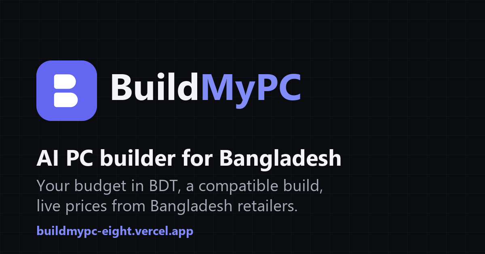
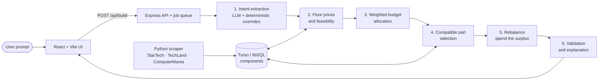

<div align="center">


# BuildMyPC

**Describe the PC you want. Get a compatible build with live Bangladeshi prices in seconds.**

AI-assisted PC configurator for the Bangladesh market: budget in BDT in, compatibility-checked parts list out.

[](https://buildmypc-eight.vercel.app)

[](https://react.dev)
[](https://vite.dev)
[](https://tailwindcss.com)
[](https://expressjs.com)
[](https://turso.tech)
[](https://www.python.org)
[](LICENSE)

[Live demo](https://buildmypc-eight.vercel.app) ·
[How it works](#how-it-works) ·
[Quick start](#quick-start) ·
[Configuration](#configuration) ·
[Deployment](#deployment) ·
[Testing](#testing)

<br />



</div>

---

## Why BuildMyPC

Picking parts in Bangladesh means juggling retailer tabs, fluctuating prices and a spreadsheet of socket and memory rules. BuildMyPC takes a sentence like

> *"Gaming PC under 80k, Intel CPU, Nvidia GPU, 144Hz monitor"*

and returns a full build: every part is **in stock**, **compatible**, **priced from a real retailer catalog**, and linked to its product page. Ask a follow-up ("make it AMD", "add a UPS", "I already have a monitor") and only the affected parts change.

## Features

| | |
|---|---|
| **Natural-language input** | English, Banglish and mixed messages: `65k`, `1.5 lakh`, `৳70,000`, `70 hajar taka`. |
| **Compatibility by construction** | CPU socket ↔ motherboard, DDR4/DDR5 across CPU, board and RAM, PSU headroom from real TDP, cooler required for hot CPUs, integrated-graphics checks for no-GPU builds. |
| **Budget-aware allocation** | AI-assigned weights split the budget per use case (a gaming build leans on the GPU, an editing build on cores and RAM). Leftover budget is spent by upgrading the highest-impact parts. |
| **Honest refusals** | If no compatible build exists at a price, it says what the cheapest viable build costs instead of returning a broken one. |
| **Iterative refinement** | Follow-ups lock unchanged categories, so one tweak never reshuffles the whole build. |
| **Swap and validate** | Swap any part for alternatives, remove parts you own, and re-validate the whole build on every change. |
| **Shareable builds** | A build encodes into the URL hash; nothing is stored server-side. |
| **Live inventory** | Python scraper keeps StarTech, TechLand and ComputerMania prices and stock fresh in Turso. |
| **Resilient backend** | Async job queue with position and ETA, per-IP rate limits, bounded queue, response caching with stampede protection. |
| **SEO-ready** | Prerendered budget landing pages, structured data and a generated sitemap. |

## How it works



1. **Intent extraction**: an LLM turns the message into a typed blueprint (budget, use case, brand and DDR preferences, per-category weights). Deterministic overrides then re-parse the hard facts (budget, "no GPU", retailer) so a model slip cannot change your numbers.
2. **Floor prices**: the cheapest compatible part per category sets the minimum viable cost. Impossible budgets fail fast with a clear message; tight ones shed optional extras (UPS, monitor, peripherals) before touching core parts.
3. **Weighted allocation**: surplus above the floor is distributed by the blueprint's weights.
4. **Selection**: parts are chosen in dependency order (CPU, motherboard, RAM, GPU, PSU, storage, case, cooler, peripherals), each constrained by what is already picked.
5. **Rebalance**: remaining budget upgrades the parts that matter most for the use case, within caps.
6. **Validation and explanation**: the finished build is re-checked end to end, and a short plain-language rationale is generated.

## Tech stack

| Layer | Technology |
|---|---|
| Frontend | React 19, Vite, Tailwind CSS 4, Framer Motion |
| Backend | Node.js, Express 5, `express-rate-limit` |
| Database | [Turso](https://turso.tech) (libSQL / SQLite) |
| AI | Any OpenAI-compatible endpoint: Ollama Cloud by default, Groq supported |
| Scraper | Python, DrissionPage, Scrapling, FastAPI dashboard |
| Hosting | Vercel (frontend), Render (backend) |

## Quick start

### Prerequisites

- Node.js 20+
- Python 3.10+ (only to run the scraper)
- A [Turso](https://turso.tech) database
- An [Ollama Cloud](https://ollama.com/settings/keys) or [Groq](https://console.groq.com/keys) API key

### 1. Install

```bash
git clone https://github.com/sheikhhossainn/pcbuilding-agent.git
cd pcbuilding-agent

npm install
npm --prefix backend install
npm --prefix frontend install
```

### 2. Configure

Create `backend/.env` (see [Configuration](#configuration)):

```env
TURSO_DATABASE_URL=libsql://your-database.turso.io
TURSO_AUTH_TOKEN=your_turso_token

AI_PROVIDER=ollama
OLLAMA_API_KEY=your_ollama_key
```

### 3. Create the schema and load parts

```bash
# create the components table and indexes in Turso
node scripts/apply_schema.js

# scrape retailers into the database (first run takes a while)
cd scraper
python -m venv venv
./venv/Scripts/activate        # macOS / Linux: source venv/bin/activate
pip install -r requirements.txt
python sync_db.py
```

The scraper checkpoints after every category and resumes from the exact point of failure.

### 4. Run

```bash
npm run start:all
```

| Service | URL |
|---|---|
| Frontend | http://localhost:5173 |
| Backend API | http://localhost:3001 |

## Configuration

### Backend (`backend/.env`)

| Variable | Required | Description |
|---|:---:|---|
| `TURSO_DATABASE_URL` | yes | libSQL URL of your Turso database |
| `TURSO_AUTH_TOKEN` | yes | Turso auth token |
| `AI_PROVIDER` | no | `ollama` (default) or `groq` |
| `OLLAMA_API_KEY` | with `ollama` | Ollama Cloud API key |
| `GROQ_API_KEY`, `GROQ_API_KEY_2` | with `groq` | Groq keys; the second is used for rate-limit rotation |
| `AI_BASE_URL` | no | Override the OpenAI-compatible base URL (default `https://ollama.com/v1`) |
| `AI_PRIMARY_MODEL` | no | Model for intent extraction (default `gpt-oss:120b`) |
| `AI_FALLBACK_MODEL` | no | Used if the primary call fails |
| `AI_EXPLANATION_MODEL` | no | Model for the build rationale |
| `PORT` | no | HTTP port (default `3001`) |

### Frontend (`frontend/.env`)

| Variable | Description |
|---|---|
| `VITE_API_BASE_URL` | Backend origin, e.g. `https://your-api.onrender.com`. Empty in dev (Vite proxies `/api`). |

### Choosing a model

Intent extraction is the only model-sensitive step. `backend/tests/eval/intentEval.mjs` scores a model on 38 realistic messages (budget, use case, brands, DDR, RAM, storage, follow-ups):

```bash
cd backend
AI_PRIMARY_MODEL=gemma4:31b AI_FALLBACK_MODEL=gemma4:31b \
  node tests/eval/intentEval.mjs --out results/gemma4.json
```

In our runs `gemma4:31b` matched `gpt-oss:120b` at 100% accuracy with roughly half the latency.

## API

| Method | Path | Purpose |
|---|---|---|
| `POST` | `/api/build` | Submit a prompt; returns a `jobId` |
| `GET` | `/api/build/:jobId` | Poll status, queue position and the finished build |
| `POST` | `/api/build/validate` | Re-validate an edited build (no AI call) |
| `POST` | `/api/parts/alternatives` | Compatible swaps for one category |
| `GET` | `/health` | Liveness + database check (`503` if the database is down) |

## Deployment

### Backend on Render

| Field | Value |
|---|---|
| Root Directory | `backend` |
| Build Command | `npm install` |
| Start Command | `npm start` |

Add the variables from [Configuration](#configuration). Render injects `PORT`. Point an uptime monitor at `/health` (every 5 to 10 minutes) to keep a free instance warm.

### Frontend on Vercel

| Field | Value |
|---|---|
| Root Directory | `frontend` |
| Framework Preset | Vite |
| Build Command | `npm run build` (runs `vite build` then the prerender step) |
| Env var | `VITE_API_BASE_URL` = your Render URL |

The build writes one static HTML file per landing page plus `sitemap.xml`. After deploying, submit the sitemap in Google Search Console.

## Testing

```bash
npm test                              # backend + frontend unit tests
npm --prefix backend run stress       # randomized engine stress harness
npm --prefix backend run stress -- --quick
```

The stress harness drives the real engine against a catalog snapshot and asserts invariants: socket and DDR compatibility, PSU headroom, cooler for hot CPUs, brand and DDR preferences honoured, total within the budget ceiling, and no crashes. See [`backend/tests/stress/README.md`](backend/tests/stress/README.md).

## Project structure

```text
.
├── frontend/                 React + Vite app
│   ├── src/components/       Builder, Hero, part rows, swap drawer, settings, SEO content
│   ├── src/seo/              Landing page copy, FAQ and structured data
│   ├── scripts/prerender.mjs Static HTML + sitemap generation
│   └── public/               Icons, social card, robots.txt
├── backend/
│   ├── ai/                   Intent prompt, extractor, explanation generator
│   ├── engine/               Orchestrator, budget allocator, part selector, validators
│   ├── routes/               Build, status, validate and alternatives handlers
│   ├── utils/                Part repository, cache, queue, spec inference, capacity parsing
│   └── tests/                Unit, property, stress and LLM eval suites
├── scraper/                  Python ETL for StarTech, TechLand and ComputerMania
├── scripts/apply_schema.js   Create the Turso schema
└── turso_schema.sql
```

## Supported retailers

| Retailer | Status |
|---|---|
| StarTech BD | Supported |
| TechLand BD | Supported |
| ComputerMania BD | Supported |

All eleven categories are covered: CPU, motherboard, RAM, storage, GPU, PSU, casing, CPU cooler, monitor, mouse and keyboard, plus UPS.

## Contributing

Issues and pull requests are welcome. Please run `npm test` and the stress harness before opening a PR, and keep changes to the recommendation engine covered by a test or a stress scenario.

## License

MIT, see [LICENSE](LICENSE). Created by [Sheikh Hossain](https://github.com/sheikhhossainn).
